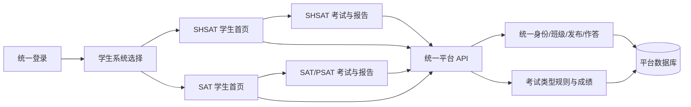

# 统一考试平台学生端：需求与设计基线

> 2026-10-15 确认。本文件说明当前学生端整合目标；已有数据库总设计仍见 [docs/DATABASE_DESIGN.md](./docs/DATABASE_DESIGN.md)，具体执行步骤见 [DEVELOPMENT_STAGES.md](./DEVELOPMENT_STAGES.md)。

## 1. 已确认的业务目标

统一平台为管理员、教师和学生提供同一套账号与登录态。学生登录后看到 **SAT** 和 **SHSAT** 两个系统入口，选中后进入对应系统的学生首页。系统内的考试页面、交互和规则沿用原独立系统；管理员继续在统一后台管理账号、班级、试卷和考试发布。

| 学生选择 | 进入页面 | 系统内部区分 |
| --- | --- | --- |
| SAT | 原独立 SAT 系统风格的学生首页 | 试卷标记 SAT 或 PSAT，沿用各自评分规则；不设置 SAT/PSAT 两个顶层入口 |
| SHSAT | 原独立新版 SHSAT 系统风格的学生首页 | 直接进入 SHSAT；不设置新旧版选择 |

旧版 SHSAT 不进入本次数据与页面迁移范围。一个学生可加入多个统一班级；管理员、教师可管理全部班级。考试开放期间新加入目标班级的学生自动获得该考试资格。所有面向用户的交互提示使用英文。

## 2. 交付范围与验收目标

### 统一入口

- 登录一次后进入系统选择页；学生切换 SAT、SHSAT 不重复登录。
- 学生、管理员与教师使用同一用户 ID 和会话；路由和后端均检查角色与数据归属。
- 系统选择只显示 SAT、SHSAT。SAT/PSAT 的类型编码继续用于试卷、考试和成绩数据，不决定顶层入口数量。

### SHSAT 学生端

- 选择 SHSAT 后直接显示原新版 SHSAT 的学生首页，包括考试卡片、已分配复习、历史作答和报告入口。
- 从首页可开考、续考、提交、查看允许展示的结果，并进入原有题型和规则对应的考试页。
- UI、交互顺序和考试规则以 `shsat_exam_system/new_system/shsat_web/src/pages/` 为对照；页面使用统一会话和当前后端 API。

### SAT 学生端

- 选择 SAT 后显示原独立 SAT 学生首页，包括已发布考试和已完成考试；保留学生原本可用的练习与报告入口。
- 开考和续考进入原 SAT 考试界面。保留 RW/Math 模块顺序、分支选择、各模块计时、休息、题目与材料展示、答题工具、自动保存、刷新恢复、提交和报告。
- SAT 与 PSAT 共用此界面，试卷显式标记类型；自适应/固定是考试模式，不能与 SAT/PSAT 类型混淆。
- 原 SAT 页面只作为交互与规则来源；页面请求必须指向统一平台后端，不能调用旧 SAT 服务或读取旧数据库。

### 成绩与历史

- SAT/PSAT 使用原系统对应的判分和量表规则，保存原始分、分项分、总分、实际作答模块与评分规则版本。
- 学生报告及管理员/教师可见的历史成绩按统一用户、班级和考试归属查询；遵守考试结果可见时间和答案可见设置。
- 已迁入的 SAT 历史记录与新产生的记录在同一学生界面中可查询；原始数据语义保持可追溯。

### 不在本阶段增加

- 旧版 SHSAT 的页面和数据迁移。
- 第三种考试类型的具体题型与规则、运行时热插拔插件。
- 第二套身份、班级或独立 SAT 服务。

## 3. 现状与差距

| 当前已有 | 尚未形成闭环 |
| --- | --- |
| 统一登录、用户与班级，SAT/SHSAT 系统目录，管理端试卷与发布基础功能，SAT/PSAT 数据迁移表和历史记录 | 学生选择后的专属首页路由；SAT/PSAT 学生考试可用能力；SAT 模块状态、分支、计时与续考；SAT/PSAT 评分和报告；旧 SAT 页面改接当前后端 |
| 新版 SHSAT 考试页及部分学生 API 已迁入 | 原新版 SHSAT `StudentHome` 未作为学生入口接入；其首页相关历史/复习数据需核对当前 API |

当前 `ExamTypePage` 的学生开考动作固定跳到 SHSAT 页面；后端 SAT/PSAT 模块没有声明支持学生作答，学生考试列表也会过滤这两类。当前通用 `StudentAttemptPage` 不能代替原 SAT 考试页面。应先完成对应规则与接口，再开放 SAT 学生开考。

## 4. 实现边界

- **前端**：沿用现有 Vue 项目。公共层负责登录、选择入口、角色保护、导航与请求；`examTypes/shsat` 和 `examTypes/sat` 分别负责学生首页、考试、报告及类型特有状态。保留原页面体验，清理复制进来的旧登录、旧 API 地址、重复导航与失效分支。
- **后端**：沿用现有 Spring Boot 项目。公共层负责发布资格、尝试次数、答案归属和结果权限；SAT 模块负责模块推进、分支、休息、题目筛选及评分；SHSAT 模块保持自己的规则。SAT 与 PSAT 共用 SAT 流程实现，但按明确类型读取各自量表。
- **数据库**：继续使用现有平台数据库与共享 `users`、`classes`、`papers`、`exams`、`attempts`、`attempt_items`、`attempt_answers`、`attempt_results`。必要时用新 Flyway 版本增加最小 SAT 实时作答状态；不要把导入历史专用的 `source_*` 字段当作新考试运行状态，也不要复制一套账号或通用作答表。评分结果引用已使用的规则版本。
- **接口**：SAT 学生端从当前平台获得可参加考试、开始/续考、当前模块题目、答案保存、模块提交、休息/过渡、完成和报告数据。服务端决定时间与可访问模块，刷新页面能恢复同一状态。

## 5. 关键规则

1. 学生只能读取自己有资格参加的考试及自己的作答、成绩；管理员/教师按统一权限查看管理数据。
2. 考试开始后固定本次试卷版本和评分规则；保存答案或刷新页面不得改变已选分支和已完成模块。
3. SAT/PSAT 的模块计时、分支选择和判分由服务端确认；前端倒计时只负责展示。
4. 报告显示受考试配置控制；未完成判分时不得展示错误的零分。
5. 新增考试类型时，复用身份、班级、发布与系统选择结构，新增该类型自己的学生页面和规则；不要求所有类型共用同一个考试界面。

## 6. 主要风险

- 原 SAT 端含旧接口、旧身份状态和兼容回退逻辑。迁入时逐项映射到当前平台 API，并清理不用的旧代码。
- SAT 量表、难度分支和原试卷材料必须按真实数据校验；不能根据试卷总分推断 SAT/PSAT。
- 已迁历史作答和新作答的数据形态不同，报告查询需兼容并保证同一学生可见性。
- 原 SHSAT 学生首页包含错题复习和历史入口；接入时应核对这些实际功能，而非只完成考试卡片外观。

详细实施和验收顺序见 [DEVELOPMENT_STAGES.md](./DEVELOPMENT_STAGES.md)。
