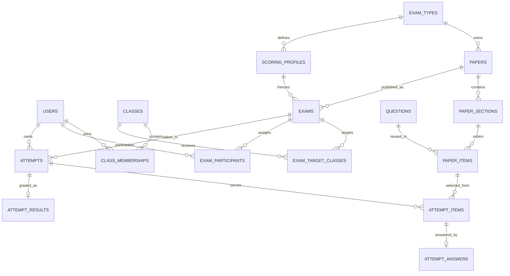

# 统一考试平台数据库设计（草案 v1）

> 范围：SAT、PSAT、新版 SHSAT，以及未来新增考试类型。本文是逻辑与物理设计约定，不包含旧系统数据迁移脚本；新库的实际 DDL 通过 `backend/src/main/resources/db/migration/` 中的 Flyway 文件维护。新平台数据库是切换后的唯一业务数据源。

## 1. 设计目标与边界

一个用户身份、一套班级、多班级成员关系、一个试卷与发布管理入口。学生登录后选择 SAT 或 SHSAT，直接进入对应系统的学生首页；SAT/PSAT 由试卷标记和评分规则区分，不设置两个学生系统入口。数据库以稳定项目编码区分试卷、发布和评分历史；SAT 与 PSAT 共用 SAT 工作区及内部实现，但仍保留各自的数据归属和评分规则。SHSAT 的 Part/子题型、各自的评分算法保留专属结构。

新增考试类型时，`exam_types` 增加编码，接入新的业务模块；如有独特结构，增加该模块自己的表。公共表不因为每新增一类考试就增加一批专属列，也不把所有业务塞进不可查询的 JSON。

### 设计约定

- 数据库建议 MySQL 8.0.16+、InnoDB、`utf8mb4`。主键统一 `BIGINT UNSIGNED`；时间统一 `DATETIME(6)` 并按 UTC 存储，展示时再转换时区。
- 表名、列名用 `snake_case`；考试类型用稳定大写编码，如 `SAT`、`PSAT`、`SHSAT`。展示名称可修改，编码不能复用。
- 所有核心关系使用外键；已发布的试卷版本、题目、材料、评分规则及历史作答不得物理级联删除。草稿的清理和归档由业务服务控制。
- `status`/`role_code` 等状态用短字符串和约束或服务端校验，不使用数据库 `ENUM` 锁死未来扩展。JSON 只存结构随题型或算法变化的配置与答案，必须有版本和服务端校验。
- 不存可由关系直接计算的 `student_count`、`question_count`、`average_score`、`rank_in_class` 等缓存值。未来若有明确性能瓶颈，再用独立读模型或缓存。
- 试卷发布时引用**不可变试卷版本**和**不可变评分规则版本**。编辑已发布内容必须产生新版本，历史考试和报告始终读原版本。

## 2. 关系概览

图中省略了可选的个人定向发布、素材、分类、练习任务和迁移审计表；下文有定义。`EXAMS` 指一次考试发布，`ATTEMPTS` 指学生的一次实际作答，二者不能混为“考试类型”。

## 3. 平台主数据

以下列名是实施时应遵守的核心契约；普通审计列除特殊说明外统一为 `created_at`、`updated_at`。表中的 `PK`、`FK`、`UQ` 分别表示主键、外键、唯一约束。

### `exam_types`：考试类型注册

| 列 | 类型 / 约束 | 含义 |
| --- | --- | --- |
| `code` | `VARCHAR(32)` PK | 稳定编码，如 `SAT`、`PSAT`、`SHSAT` |
| `display_name` | `VARCHAR(80)` NOT NULL | 项目名称；系统工作区名称由代码注册提供 |
| `is_active` | `BOOLEAN` NOT NULL | 是否允许新建试卷/发布；停用后历史仍可读 |
| `sort_order` | `INT` NOT NULL | 展示顺序 |

项目所属工作区和能力由**代码模块注册**决定；例如 SAT 与 PSAT 的独立项目编码都映射到 SAT 工作区，前端只显示一个 SAT 系统入口。数据库行本身不能让一种新考试自动具备这些功能。不存前端 URL、Java 类名或插件配置，避免部署细节进入业务数据。

### `users`：唯一身份源

`id` PK；`username VARCHAR(80)` UQ、`password_hash VARCHAR(255)`、`real_name VARCHAR(80)`、`role_code VARCHAR(20)`、`email VARCHAR(160) NULL`、`phone VARCHAR(30) NULL`、`status VARCHAR(20)`、`last_login_at NULL`、审计时间。`role_code` 首期只有 `ADMIN`、`TEACHER`、`STUDENT`，一个账号一个角色；当前业务没有多角色需求，因此不建 `roles` + `user_roles` 两张表。`username` 统一大小写/空白规范后再做唯一约束；邮箱在旧库可能冲突，首期不作身份唯一键。密码只存哈希，不存明文。

如将来确认一人多角色，再增加角色关系表并迁移该字段，不在当前方案预设空转的权限表。服务端仍必须按角色执行授权，页面显示不能代替后端校验。

### `classes` 与 `class_memberships`：一套班级

- `classes`：`id` PK、`name VARCHAR(100)`、`description VARCHAR(500) NULL`、`status VARCHAR(20)`、`sort_order INT`、审计时间。班级名不作全局唯一：不同年度可能同名；需要时由业务增加 `academic_year` 并以组合规则校验。
- `class_memberships`：`class_id` FK、`student_user_id` FK，组合 PK；`joined_at`、`left_at NULL`。`left_at IS NULL` 表示当前在班。一个学生可在多个班；教师按已确认规则可管理全部班级，因此不设强制 `teacher_id` 或每班专属教师关系。服务端保证成员只关联 `STUDENT` 用户。

此表保留一条班级与学生关系；离班后再次入班时重启该关系，完整操作轨迹由审计日志记录。考试参与资格由下文独立表冻结，因此不会因离班而丢失既有作答与成绩。

### `audit_events`：关键管理操作

`id` PK、`actor_user_id` FK、`action_code VARCHAR(60)`、`entity_type VARCHAR(40)`、`entity_key VARCHAR(100)`、`detail_json JSON NULL`、`occurred_at`。记录账号合并、权限变更、班级成员变更、试卷发布与撤回等操作；`detail_json` 不写密码哈希、令牌和完整敏感个人资料。使用字符串实体键以兼容数值主键与考试类型编码；审计索引为 `(actor_user_id, occurred_at)` 和 `(entity_type, entity_key, occurred_at)`。

## 4. 试卷、题库与素材

### `paper_groups` 与 `papers`

- `paper_groups`：`id` PK、`exam_type_code` FK、`name`、`sort_order`、审计时间。分组属于考试类型；`UQ(exam_type_code, name)`。
- `papers`：`id` PK、`exam_type_code` FK、`group_id NULL` FK、`paper_code VARCHAR(80)`、`version_no INT UNSIGNED`、`title VARCHAR(200)`、`description NULL`、`status`（`DRAFT`/`READY`/`ARCHIVED`）、`default_duration_seconds NULL`、`source_paper_id NULL` FK、`created_by` FK、`sealed_at NULL`、审计时间；`UQ(exam_type_code, paper_code, version_no)`。

一行 `papers` 就是一份**确定版本**，没有额外的 `paper_versions` 空壳表。`paper_code` 相同、`version_no` 不同代表同一套卷的不同版本；`source_paper_id` 只记录从哪一版复制而来。`READY` 且 `sealed_at` 非空才可发布；发布后仅允许改不影响考试语义的展示字段，改题目或答案须复制为下一版。删除历史版本只允许在没有任何发布或作答引用时进行。

### `assets`、`materials` 与 `paper_assets`

- `assets`：`id` PK、`storage_key VARCHAR(500)` UQ、`mime_type VARCHAR(100)`、`original_name VARCHAR(255)`、`size_bytes BIGINT UNSIGNED`、`sha256 CHAR(64) NULL`、`created_at`。数据库保存资源元数据和对象存储键，不保存文件二进制和带时效的下载 URL。
- `materials`：`id` PK、`kind VARCHAR(30)`、`title NULL`、`body LONGTEXT NULL`、`asset_id NULL` FK、`sealed_at NULL`、审计时间。文本、图片、PDF、表格等共用材料实体；具体呈现由题目模块负责。`body` 与 `asset_id` 至少有一个有值。
- `paper_assets`：`paper_id` FK、`asset_id` FK、`purpose VARCHAR(30)`、`sort_order INT`，组合 PK `(paper_id, asset_id, purpose)`。例如 SHSAT 答案 PDF、试卷附件；不为每种资源新建一张同构表。

### `question_categories` 与 `questions`

- `question_categories`：`id` PK、`exam_type_code` FK、`parent_id NULL` 自关联、`code VARCHAR(60)`、`name VARCHAR(100)`；`UQ(exam_type_code, code)`。用于 SAT/PSAT 技能和知识点树、SHSAT 分类等。`question_type_code` 是作答交互类型，和这里的知识点分类不同。
- `questions`：`id` PK、`question_type_code VARCHAR(50)`、`payload_schema_version SMALLINT UNSIGNED`、`material_id NULL` FK、`stem LONGTEXT`、`render_json JSON NULL`、`answer_key_json JSON NOT NULL`、`grading_json JSON NULL`、`explanation LONGTEXT NULL`、`sealed_at NULL`、审计时间。`render_json` 保存选项及交互组件配置；`answer_key_json` 单独保存标准答案，学生接口绝不返回；`grading_json` 保存题目级特殊评分参数。三个 JSON 的结构由 `(exam_type_code, question_type_code, payload_schema_version)` 对应的考试模块校验和读取，不能由通用层随意改写。

题目本身不绑定 SAT/PSAT/SHSAT，便于 SAT 与 PSAT 复用同一道题；它能否放入某类型试卷由对应考试模块校验。题目被已发布版本引用后即不可语义修改，需要改时复制新题目 ID。材料同理。不同考试可以有完全不同的题型和答案形态；平台只定义承载字段，不假设它们都是选择题，也不把题型结构压成统一的选项列。读写必须由考试模块按明确的 schema 版本完成，未知版本不得静默丢字段后再保存。

Flyway V7 增加 `questions.payload_schema_version`，默认版本为 1；试卷详情、编辑往返和学生作答载荷都必须携带该版本。每个类型模块负责解释并校验自己的题目 JSON，不认识的题型/版本应明确报错，禁止读后按旧格式保存造成静默降级。

### `paper_sections` 与 `paper_items`

- `paper_sections`：`id` PK、`paper_id` FK、`parent_section_id NULL` 自关联、`section_code VARCHAR(60)`、`section_kind VARCHAR(30)`、`title`、`sort_order INT`、`instructions NULL`、`settings_json JSON NULL`；`UQ(paper_id, section_code)`，索引 `(paper_id, parent_section_id, sort_order)`。这是可变深度的试卷树，不限定固定的“科目/模块/Part”列。`section_kind` 和合法父子关系由考试模块校验：SHSAT 可表达 ELA → 子题型、Math → 子题型；SAT/PSAT 可表达科目 → 自适应阶段 → 分支；新考试可定义自己的层级。模块特有且需要查询/约束的规则放到以 `section_id` 为主外键的扩展表，少量呈现参数放 `settings_json`。兄弟节点顺序唯一性由领域服务校验，避免 MySQL 对可空 `parent_section_id` 的唯一索引允许多个根节点重号。
- `paper_items`：`id` PK、`section_id` FK、`question_id` FK、`category_id NULL` FK、`sort_order INT`、`display_number INT NULL`、`max_points DECIMAL(8,2)`、`scoring_section_code VARCHAR(30) NULL`；`UQ(section_id, sort_order)`。题号允许在互斥的 SAT 自适应分支中重复；不设全卷题号唯一。题目与材料内容只存一份，试卷中的位置、分类和分值由关联表保存。同一道题用于 SAT/PSAT 时可按考试类型归入不同知识点。

对 `parent_section_id` 与 `section_id` 的归属一致性、同一题目/材料不能在已封存版本中修改等跨表规则，由同一事务中的领域服务校验。实施 DDL 时可对 `paper_sections(id, paper_id)` 增加组合候选键和组合外键，强制父子属于同一试卷。`paper_items` 可在迁移时检查其题型是否被对应考试类型模块支持。

## 5. 评分规则、考试发布与资格

### `scoring_profiles` 与 `scoring_scale_rows`

- `scoring_profiles`：`id` PK、`exam_type_code` FK、`profile_code VARCHAR(80)`、`version_no INT`、`name`、`algorithm_code VARCHAR(50)`、`config_json JSON NULL`、`is_estimated BOOLEAN`、`sealed_at NULL`、审计时间；`UQ(exam_type_code, profile_code, version_no)`。算法代码对应考试模块中的实现，`config_json` 放该实现的版本化参数，例如 SAT/PSAT 自适应阈值、SHSAT 分段定义。
- `scoring_scale_rows`：组合 PK `(profile_id, section_code, variant_code, raw_score)`；`scaled_score INT`。`variant_code` 不为空，普通量表用 `DEFAULT`，SAT/PSAT 可以用模块阶段与难度组合。只有真正采用原始分→量表分映射的 profile 才有这些行；纯公式算法无需空量表。

评分 profile 一旦用于已发布考试就封存；修订算法或量表应建新版本。`exams.scoring_profile_id` 固定使用发布时的版本，`attempt_results` 记录实际评分算法版本。这样重算历史分数需要明确的管理动作，不会因新规则上线而悄悄改变旧报告。

### `exams`：考试发布实例

`id` PK、`paper_id` FK、`scoring_profile_id` FK、`title VARCHAR(200)`、`description NULL`、`status`（`DRAFT`/`PUBLISHED`/`CLOSED`/`CANCELLED`）、`target_scope`（`ALL_STUDENTS`/`SELECTED`）、`opens_at`、`closes_at`、`duration_seconds NULL`、`attempt_limit INT`、`answer_visibility`、`score_visibility`、`auto_submit BOOLEAN`、`allow_review BOOLEAN`、`created_by` FK、`published_at NULL`、`archived_at NULL`、审计时间。索引 `(status, opens_at, closes_at)`、`(paper_id, status)`；约束 `closes_at > opens_at`、`attempt_limit >= 1`。

考试类型从 `papers.exam_type_code` 得出，不在 `exams` 再存一份。发布事务必须验证 paper 与 profile 的类型一致且都已封存。`duration_seconds` 是本次发布的考试总时长；SAT/PSAT 的逐模块时长另由专属规则记录。`archived_at` 只是后台列表隐藏，不删除已有成绩。

### `exam_target_classes`、`exam_target_students` 与 `exam_participants`

- `exam_target_classes`：组合 PK `(exam_id, class_id)`，两个字段分别 FK。保存“向哪些班级发布”，不存 JSON ID 列表。
- `exam_target_students`：组合 PK `(exam_id, student_user_id)`，两个字段分别 FK。保存单独指定的学生。`target_scope=ALL_STUDENTS` 时两张目标表应为空；`SELECTED` 时至少有一项目标，由发布事务校验。
- `exam_participants`：组合 PK `(exam_id, student_user_id)`；`assigned_at`、`revoked_at NULL`、`signed_in_at NULL`、`absent_marked_at NULL`、`seat_no NULL`。保存实际资格与签到/缺考状态。学生同时属于多个目标班级仍只有一条资格记录；没有考试尝试不代表缺考，缺考应由明确规则或管理动作标记。

目标表表达**发布范围**，参与表表达**具体学生的稳定资格**，二者职责不同。当前规则是：发布时把目标班级中的有效学生和单独指定的学生写入 `exam_participants`；考试开放期间新加入目标班级的有效学生也自动加入资格。考试开放前新入班的学生不会自动加入本次考试。离班不撤销已获得的资格，开始作答后更不得删除历史记录。`exam_participants` 可用 `(student_user_id, revoked_at, exam_id)` 索引查学生待考列表。

## 6. 作答、评分结果与报告

### `attempts`：一次作答的生命周期

当前 Flyway V3 先实现正式考试场景所需的精简结构：`id`、`exam_id`、`student_user_id`、`attempt_no`、`status`（`IN_PROGRESS`/`SUBMITTED`）、`started_at`、`expires_at`、`submitted_at`。组合外键 `(exam_id, student_user_id)` 指向已生成的 `exam_participants` 资格；`UQ(exam_id, student_user_id, attempt_no)` 保证每次尝试编号唯一。一次只允许存在一个进行中的尝试由服务端事务控制。模块专属监考事件在 V4 通过 `shsat_exam_monitor_events` 引用统一 `attempts`，不再复制一套作答记录。

`id` PK、`student_user_id` FK、`exam_id NULL` FK、`practice_paper_id NULL` FK、`practice_scoring_profile_id NULL` FK、`mode`（`EXAM`/`PRACTICE`/`REVIEW`）、`attempt_no INT`、`source_attempt_id NULL` FK、`status`（`NOT_STARTED`/`IN_PROGRESS`/`SUBMITTED`/`COMPLETED`/`EXPIRED`/`CANCELLED`）、`started_at NULL`、`submitted_at NULL`、`effective_duration_seconds NULL`、`progress_json JSON NULL`、审计时间。

上面这一段是后续完整模型的设计方向；本期不创建练习字段和未使用状态，待练习/错题重做确有需求时通过迁移扩展。

正式考试只填 `exam_id`，个人练习/错题重做只填 `practice_paper_id` 与 `practice_scoring_profile_id`；`exam_id` 和 `practice_paper_id` 必须恰好一个非空。这样不为正式考试重复存 `paper_id`，练习仍可直接指向试卷与评分版本。正式作答受 `UQ(exam_id, student_user_id, attempt_no)` 约束；`attempt_no` 不超过该发布的 `attempt_limit`。`progress_json` 只保存考试模块的断点续考状态，带格式版本，不能替代服务端状态与时间校验。

### `attempt_items` 与 `attempt_answers`

- `attempt_items`：组合 PK `(attempt_id, paper_item_id)`；`served_order INT` 和 `UQ(attempt_id, served_order)`。记录学生这次实际拿到的题目，未作答题目也有此行。SAT/PSAT 自适应分支、SHSAT 错题子集或重排题目可在后续继续扩展呈现快照。
- `attempt_answers`：组合 PK `(attempt_id, paper_item_id)`，组合 FK 指向 `attempt_items`；当前保存 `answer_json JSON`、`is_correct BOOLEAN NULL`、`awarded_points DECIMAL(8,2) NOT NULL DEFAULT 0` 和 `answered_at`。未答题不创建答案行；`is_correct=NULL` 表示尚未判分或该题型暂不支持自动评分。历史标准答案由已封存题目版本提供，不重复存一份 `correct_answer` 文本。人工评分明细、耗时与标记状态在对应功能实现后再增加。

答题表只写学生提交的值和该题评分结果；标准答案与题目配置从不可变题目/试卷版本读取。迁移时若发现旧系统曾在考试后修改过原题，须恢复当时内容并生成独立版本，再关联旧作答，不能直接把全部历史作答指向当前题面。

### `attempt_results` 与 `attempt_result_breakdowns`：最终成绩

`attempt_results` 保存跨类型都成立的汇总：`attempt_id` PK/FK、`scoring_profile_id` FK、`algorithm_version VARCHAR(80)`、`total_points`、`max_points`、`ungraded_count`、`breakdown_schema_version SMALLINT UNSIGNED`、`breakdown_json JSON`、`graded_at`、`is_estimated BOOLEAN`。评分 profile 指向不可变规则版本；`breakdown_json` 保存模块产生的完整、版本化成绩文档，保留通用模型尚未显式建模的报告字段。

需要在列表和报告中查询、排序或聚合的分科结果另存为 `attempt_result_breakdowns`：`attempt_id` FK、`breakdown_code VARCHAR(200)`、`parent_breakdown_code NULL`、`dimension_kind VARCHAR(30)`、`display_name VARCHAR(120)`、`sort_order INT`、`raw_score DECIMAL(10,2) NULL`、`raw_max_score DECIMAL(10,2) NULL`、`scaled_score DECIMAL(10,2) NULL`、`scaled_max_score DECIMAL(10,2) NULL`、`metrics_json JSON NULL`；组合 PK `(attempt_id, breakdown_code)`，并通过 `(attempt_id, parent_breakdown_code)` 自关联到同一次作答的父项。每个维度的 code 在一次结果内稳定且唯一。SHSAT 可保存 ELA、Math 作为父节点，并在其下保存原系统已有的子题型/技能标签；新考试可以保存自己的任意层级，模块专属指标留在 `metrics_json` 和版本化 `breakdown_json` 中。

这样既不向公共结果表添加 `ELA`、`Math` 等类型专属列，也不要求所有分析都解析 JSON。没有分科需求的考试只写汇总行；有查询需求的维度写通用树行。评分模块负责计算和产出结果，公共层负责保存与展示通用总分。新增考试类型无需改公共表；只有其规则需要数据库约束或高频查询时，才增加该类型的规则扩展表。

Flyway V7 为当前结果摘要补充所用评分 profile、算法版本、结果 schema 版本及估算标记，并创建 `attempt_result_breakdowns`。保存成绩时按试卷 section 树累计每层的得分、满分和答题计数；SHSAT skill tag 可作为当前 section 的子维度。评分量表转换接入后，同一维度可同时保存原始分和量表分。

报告页面可由已封存试卷、作答、成绩与算法版本重建；只有需要下载的 PDF 才使用 `report_asset_id`。班级平均分、排名与技能分析初期按查询计算，不在用户/班级/成绩表提前维护多份冗余数据。

## 7. 考试类型专属表与后续扩展

公共表只负责定位、发布、作答身份和最终结果。考试规则需要可约束、可查询的结构时，就建专属表；不将所有特殊字段塞进 `exams.settings_json`。

### SAT / PSAT 共用实现

| 表 | 主键与核心列 | 原因 |
| --- | --- | --- |
| `sat_module_rules` | `section_id` PK/FK → `paper_sections`；`subject_code`（RW/MATH）、`stage_no`（1/2）、`branch_code`（BASE/LOW/MID/HIGH）、`time_limit_seconds` | 自适应模块的科目、阶段、难度和计时是可约束的结构字段 |
| `sat_exam_rules` | `exam_id` PK/FK → `exams`；`delivery_mode`（ADAPTIVE/FIXED）、`rest_seconds` | 旧 SAT `exam.exam_type` 表示模式，不是 SAT/PSAT 类型；在新库明确拆开 |

SAT 和 PSAT 通过 `papers.exam_type_code` 明确区分，可共享上述表与代码模块，但评分 profile 分别归属 SAT、PSAT。不得再用试卷总分 1600/1520 推断考试类型。

当前已实现的 SAT 编辑存储继续复用 `papers`、`paper_sections`、`paper_items` 和 `questions`：RW/Math 模块作为 section，模块科目、序号、难度与时长保存在 `paper_sections.settings_json`；题干、选项、答案、解释和计分数据使用共享题目字段，SAT 特有题型元数据保存在带版本的题目 JSON 中。`sat_paper_settings` 单独保存 SAT/PSAT 计分表、自适应设置和休息时长。可复用阅读材料使用 `sat_materials`，`sat_question_materials` 将材料关联到共享题目；题目 ID 不因编辑而重建。上述实体由 Flyway V10、V11 创建。SAT 考试结构保留在 SAT 模块中，不要求 SHSAT 采用相同结构。

### SHSAT 专属设置

SHSAT 的 Part/子题型层级可直接由 `paper_sections` 表达，结构化题目由 `questions.render_json`、`answer_key_json` 与 SHSAT 题型模块表达，因此不为其复制一套与 `paper_sections` 同构的 Part 表。当前 SHSAT 的学生延时倍率可放在 `shsat_student_accommodations(student_user_id PK/FK, time_multiplier DECIMAL(4,2), updated_at)`；只有被 SHSAT 模块使用，不污染通用用户表。考试开始时把实际生效时长写入 `attempts.effective_duration_seconds`，保留历史快照。

Flyway V4 为新版 SHSAT 后台补入必要的专属字段与表：`paper_groups.description` 延续原分组说明；`papers.default_scoring_profile_id` 固定试卷默认评分档案；`shsat_section_materials` 将原材料编辑器内容挂到通用层级；`shsat_question_metadata` 保存 SHSAT 技能标签；`shsat_exam_monitor_events` 保存监考事件；`shsat_wrong_answer_tasks` 与 `shsat_wrong_answer_assignments` 保存错题任务及按学生冻结的题目集合。V5 增加量表行、学生考试延时配置、分段续考状态和 PDF 解析文件元数据。身份、班级、试卷、考试、题目和作答仍复用平台主表。资源文件的上传与下载需接入平台文件存储能力，业务表保存资源键而非旧系统本地文件路径。

### 现有错题重做与监考能力

- `review_tasks`：`id` PK、`source_exam_id` FK、`target_class_id` FK、标题、开始/截止时间、状态、创建人。若后续所有类型均使用错题重做，此表可复用。
- `review_assignments`：组合 PK `(task_id, student_user_id)`、`source_attempt_id` FK、`practice_attempt_id NULL` FK、状态。一个学生一个任务只分配一次。
- `review_assignment_items`：组合 PK `(task_id, student_user_id, paper_item_id)`；保存该学生实际被指定的错题，而不是在 JSON 中堆题号。
- `attempt_live_state`：`attempt_id` PK/FK、`current_paper_item_id NULL`、`entered_at NULL`、`last_seen_at`、`focus_violation_count`。仅在监考功能纳入新平台时启用；心跳高频更新与 `attempts` 生命周期分开，避免相互争用。

这些表有明确业务行为才创建，不要求每个新考试类型都预先生成一套空表。未来类型若有独特流程，可增加如 `<type>_section_rules`、`<type>_exam_rules`、`<type>_accommodations`，但必须继续使用公共 `papers`、`exams`、`attempts` 的主键与关系，不复制账号和班级。

例如以后新增 `IELTS`：先注册类型编码；听力、阅读等结构可以进入 `paper_sections`，通用题目进入 `questions` 和 `paper_items`，再为音频播放限制等独特规则建 `ielts_exam_rules`。学生仍关联原 `users` 与 `class_memberships`，发布仍使用 `exams` 和目标表。若某种题型的结构需要按字段查询、约束或大量更新，应建类型专属子表；仅用于渲染和判分的局部配置才放版本化 JSON。

## 8. 索引、约束和删除策略

| 场景 | 关键约束 / 索引 |
| --- | --- |
| 统一账号 | `users.username` 唯一；`users(role_code, status)` 用于管理筛选 |
| 多班级 | `class_memberships` PK `(class_id, student_user_id)`；反向索引 `(student_user_id, left_at)` |
| 类型与试卷 | `papers(exam_type_code, status, group_id)`；`UQ(exam_type_code, paper_code, version_no)` |
| 试卷编辑 | `paper_sections(paper_id, parent_section_id, sort_order)`、`paper_items(section_id, sort_order)` |
| 考试列表 | `exams(status, opens_at, closes_at)`；目标表各以 `(exam_id, target_id)` 为 PK |
| 学生资格 | `exam_participants` PK `(exam_id, student_user_id)`，反向索引 `(student_user_id, revoked_at, exam_id)` |
| 作答 | `UQ(attempts.exam_id, attempts.student_user_id, attempts.attempt_no)`；`attempts(student_user_id, started_at)`；`attempt_items` 与 `attempt_answers` 用组合键 |
| 评分 | `scoring_scale_rows` PK `(profile_id, section_code, variant_code, raw_score)`；`attempt_results.attempt_id` PK |

历史业务引用使用 `ON DELETE RESTRICT`。账号禁用、班级停用、试卷归档、发布归档不删除实体；草稿若没有下游引用，才可显式清理。`attempt_answers` 对 `attempt_items` 使用组合 FK，避免出现“回答了本次未呈现题目”的孤儿数据。高频索引以真实查询和数据量再校正，不预设每个可筛选字段都有索引。

跨表类型一致性在同一事务中校验：`papers` 与 `paper_groups`、`paper_items` 与 `question_categories`、`exams` 与 `scoring_profiles` 必须指向相同考试类型；正式 `attempts` 必须先有对应 `exam_participants` 资格，且呈现题目必须属于该考试引用的试卷版本。以上校验不能仅靠前端。可对关键组合增设候选键与组合外键；为避免在每张明细表重复存 `exam_type_code`，不把类型编码冗余复制到所有后代记录。

## 9. 旧库数据的落点（只定义映射，不写脚本）

| 来源 | 新库落点与注意事项 |
| --- | --- |
| SAT `user`、SHSAT `users` / `class_students` | 合并到 `users`、`classes`、`class_memberships`；SHSAT `student_id` 不再作为第二套身份主键；同名账号人工核对后归并 |
| SAT/PSAT `paper`、`paper_module`、`paper_question` | `papers`、`paper_sections`、`sat_module_rules`、`paper_items`；须根据真实业务字段确认 SAT 与 PSAT，不能只靠总分猜测 |
| SHSAT `paper`、`paper_part`、`paper_sub_type`、`question` | `papers`、`paper_sections`、`questions`、`paper_items`；保留已发布版本与题型 JSON 语义 |
| 两边的 `material`、PDF / 图片 | `materials`、`assets`、`paper_assets`；文件要搬迁并校验可访问性，不只搬数据库 URL |
| SAT `exam`、`user_exam`；SHSAT `exam` / target JSON | `exams`、目标班级/个人关系表、`exam_participants`；SAT `exam_type` 转为 `sat_exam_rules.delivery_mode` |
| SAT `exam_record`、`user_answer`、`score_record`；SHSAT `attempt`、`attempt_answer`、快照 | `attempts`、`attempt_items`、`attempt_answers`、`attempt_results`；保留每次实际呈现的题目及历史评分依据 |
| SAT `scoring_version`、`module_scoring`；SHSAT `scoring_profile`、`scoring_scale_row` | `scoring_profiles`、`scoring_scale_rows` 与类型模块配置；历史发布继续指向原规则版本 |

迁移核对可保留 `migration_legacy_map(source_system, entity_type, legacy_id, new_id, migrated_at)`，组合 PK `(source_system, entity_type, legacy_id)`。它只用于迁移审计和问题追踪，运行时业务不通过旧 ID 找用户或试卷；`new_id` 不能设置多态外键，需由迁移校验报告确认。多条旧账号映射到一个新用户是允许的，反向不唯一。

## 10. 尚需业务确认，不阻塞核心表设计

1. 发布后新入班学生是否自动得到尚未结束考试的资格。目标表与参与表分离后，两种策略均可实现。
2. 教师除管理全部班级外，是否也有全部试卷编辑、发布和成绩查看权限。这影响服务端授权，不要求提前增加角色关系表。
3. 首期是否包含监考、错题重做和可下载报告。相关表边界已明确，可按功能纳入时创建。

本设计的核心原则是：**统一身份与发布关系，封存试卷和评分版本；题型、考试流程及专属配置沿模块边界扩展。**
